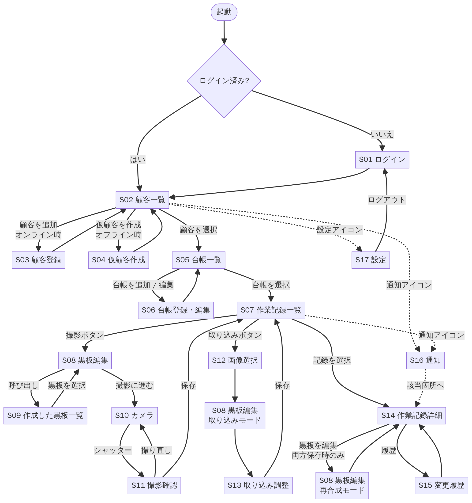
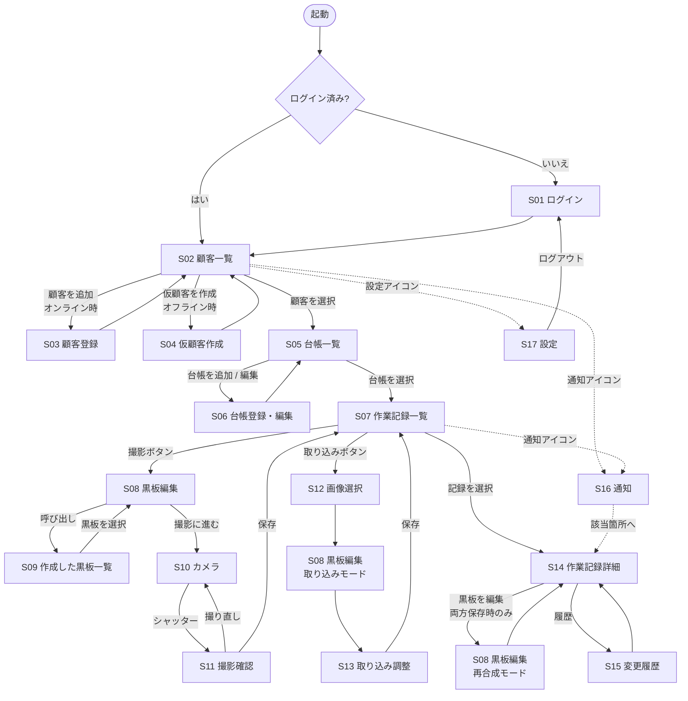
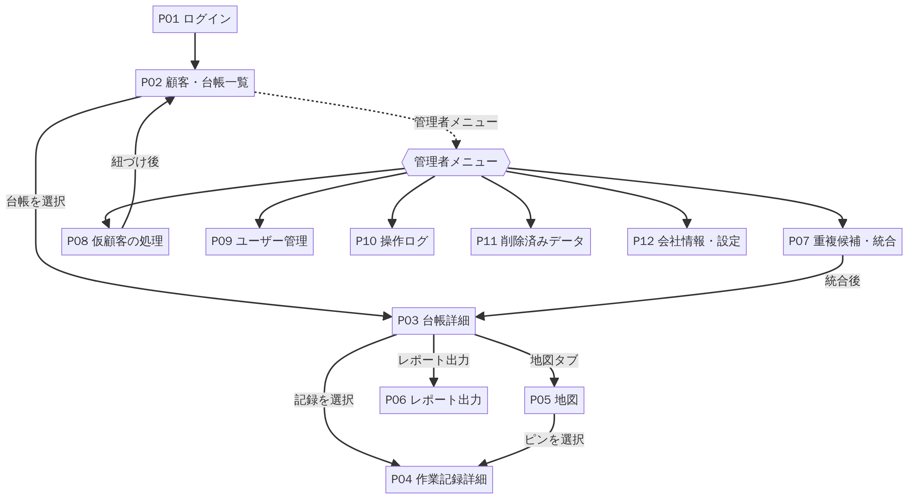
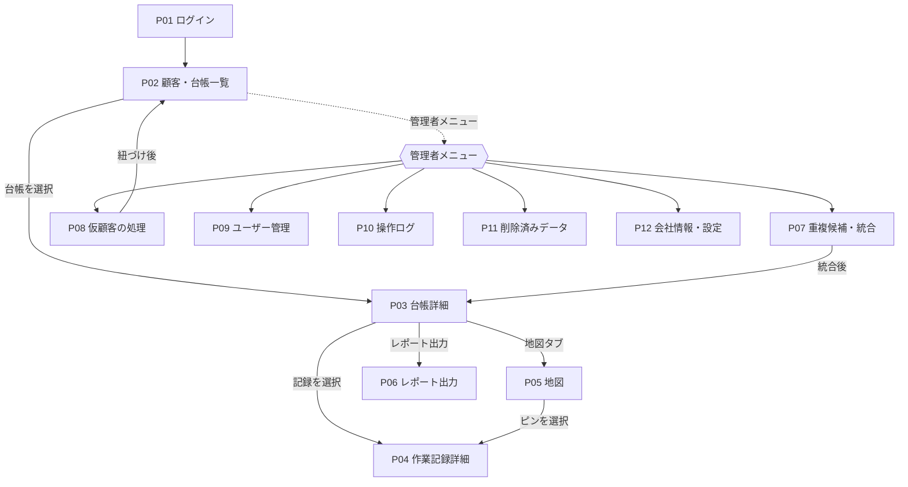

# GeoBoard 画面一覧・画面遷移

- バージョン：0.1（ドラフト）
- 作成日：2026-11-16
- 関連：[要件定義書](./requirements.md)

---

## 1. スマホアプリの画面一覧

| ID | 画面名 | 主な内容 | 関連する要件 |
|---|---|---|---|
| S01 | ログイン | メールアドレス・パスワード入力。初回のみ表示（ログアウトまで保持） | 4.1 |
| S02 | 顧客一覧 | 顧客の一覧・検索。オンライン時は「顧客を追加」、オフライン時は「仮顧客を作成」を表示。上部に通知アイコン | 6.1 |
| S03 | 顧客登録 | 顧客名を入力（オンラインのみ）。コードはサーバーで採番 | 6.1 |
| S04 | 仮顧客作成 | 顧客名のみ入力（オフライン時のみ） | 6.1 |
| S05 | 台帳一覧 | 選択した顧客の台帳一覧。並び替え・検索、「台帳を追加」 | 6.2 |
| S06 | 台帳登録・編集 | 工事名称、工期、工事責任者、備考 | 6.2 |
| S07 | 作業記録一覧 | リスト / グリッド切り替え、未送信バッジ・再送、下部に撮影ボタン・取り込みボタン | 6.3 |
| S08 | 黒板編集 | 最後に使った黒板を表示。項目タップで項目名・内容を編集、「作成した黒板」の保存・呼び出し、黒板オフ、撮影モード選択、次回への引継ぎ事項（レポート掲載の有無）、「撮影に進む」 | 6.4 |
| S09 | 作成した黒板一覧 | 全員共有の黒板一覧。並び替え・検索、呼び出し、削除（作成者・管理者のみ） | 6.4 |
| S10 | カメラ | 黒板の重ね合わせ・移動・拡大縮小、ズーム、グリッド線、水平器、縦横対応 | 6.5 |
| S11 | 撮影確認 | 撮影した写真のプレビュー、撮り直し / 保存 | 6.5 |
| S12 | 画像選択 | 端末の写真から複数枚を選択（OSの標準ピッカー） | 6.6 |
| S13 | 取り込み調整 | 黒板の配置を1枚目で決めて一括適用、個別調整、撮影日の確認、撮影モード選択 | 6.6 |
| S14 | 作業記録詳細 | 写真の拡大、黒板あり / なし切り替え、位置情報、メモ、引継ぎ事項の修正、編集・削除 | 6.7 |
| S15 | 変更履歴 | 対象の変更履歴の一覧、以前の内容に戻す | 7.3 |
| S16 | 通知 | 衝突、重複候補、仮顧客の通知一覧 | 6.1, 6.2, 7.3 |
| S17 | 設定 | 接続先（管理者のみ）、未送信警告日数、ユーザー情報、ログアウト、ストレージ使用量 | 6.8 |
| S18 | ホーム画面追加の案内 | ブラウザのタブで開いた場合に、ホーム画面への追加手順を表示 | 7.1 |

### スマホでの管理者向け操作

台帳の統合と仮顧客の確定は、PC管理画面で行うことを基本とする。スマホのS16（通知）からは、該当するPC管理画面へのリンクを表示するのみとする。

---

## 2. PC管理画面の画面一覧

| ID | 画面名 | 主な内容 | 関連する要件 |
|---|---|---|---|
| P01 | ログイン | スマホと同じアカウントでログイン | 4.1 |
| P02 | 顧客・台帳一覧 | 左に顧客ツリー、右に台帳一覧。検索・絞り込み、重複候補・仮顧客のバッジ | 8.1 |
| P03 | 台帳詳細 | 台帳情報、作業記録の一覧（リスト / グリッド）、地図タブ、ZIPダウンロード、レポート出力ボタン | 8.1 |
| P04 | 作業記録詳細 | 写真の拡大、黒板あり / なし切り替え、黒板内容、位置情報、変更履歴 | 8.1 |
| P05 | 地図 | 台帳内の撮影地点をピン表示（国土地理院 標準地図 / 航空写真） | 8.1 |
| P06 | レポート出力 | 撮影日の範囲、黒板あり / なし、写真の除外を選んでPDF出力。プレビュー表示 | 8.2 |
| P07 | 重複候補・統合 | 候補の一覧、左右比較で項目ごとに残す値を選択、統合 / 重複ではない / 統合の取り消し（管理者） | 6.2 |
| P08 | 仮顧客の処理 | 仮顧客の一覧、既存顧客へ紐づけ / 正式登録（管理者） | 6.1 |
| P09 | ユーザー管理 | ユーザーの発行・停止・権限変更（管理者） | 4.1 |
| P10 | 操作ログ | 全体の操作ログと変更履歴の閲覧（管理者） | 4.3 |
| P11 | 削除済みデータ | 論理削除されたデータの一覧と復元（管理者） | 4.3 |
| P12 | 会社情報・設定 | 施工会社名、ロゴ、接続先（管理者） | 8.1 |

---

## 3. 画面遷移図（スマホアプリ）





## 4. 画面遷移図（PC管理画面）





---

## 5. 主要画面のレイアウト概要

### S07 作業記録一覧

```
┌────────────────────────────┐
│ ←  工事名称            [表示切替][通知] │
│ 未送信 2件  送信中 1/2   [再送]   │
├────────────────────────────┤
│ [写真] 2026/11/16  作業場所       │
│        作業内容 / 施工者   未送信 │
│ [写真] 2026/11/15  作業場所       │
│        作業内容 / 施工者          │
│  ...                               │
├────────────────────────────┤
│   [ 画像取り込み ]  [ ● 撮影 ]    │
└────────────────────────────┘
```

### S08 黒板編集

```
┌────────────────────────────┐
│ ←  黒板編集        [作成した黒板] │
├────────────────────────────┤
│ ┌──────────────────────┐ │
│ │ 顧客名   │ ○○町役場           │ │
│ │ 作業場所 │ ○○山 山頂          │ │
│ │ 作業内容 │ 中継器設置          │ │
│ │ 機材     │ GEO-WAVE中継器/太陽光 │ │
│ │ 撮影日   │ 2026/11/16          │ │
│ │ 備考     │ （折り返し表示）      │ │
│ │          │ （3行分の高さ）       │ │
│ │ 施工者名 │ 芦田                │ │
│ └──────────────────────┘ │
│ [この黒板を保存]   [黒板オフ]      │
│ 撮影モード：(●)あり ( )両方        │
│ 次回への引継ぎ事項 [            ]  │
│ [ ] レポートに載せる                │
├────────────────────────────┤
│          [ 撮影に進む ]            │
└────────────────────────────┘
```

### S10 カメラ（縦向き）

```
┌────────────────────────────┐
│ [グリッド] [水平器]       x1.0    │
│                                    │
│        （カメラ映像）              │
│            ─── 水平器 ───          │
│                                    │
│  ┌───────┐                     │
│  │ 黒板      │ ← ドラッグで移動  │
│  │           │    ピンチで拡縮    │
│  └───────┘                     │
├────────────────────────────┤
│  [戻る]        ( ◯ )              │
└────────────────────────────┘
```
